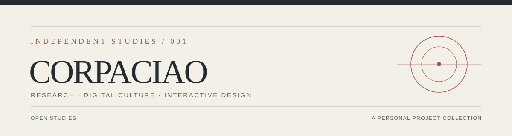

<p align="center"></p>

# CORPACIAO

**An independent collection of interactive studies at the intersection of research, design, and culture.** This repository contains browser-based editorial experiences and a reproducible Python dataset-audit exercise.

**[Explore the website](https://eldeville1-hue.github.io/corpaciao/)** · **[Night Sky Atlas](https://eldeville1-hue.github.io/corpaciao/night-sky-atlas/)** · **[History of Colors](https://eldeville1-hue.github.io/corpaciao/history-of-colors/)**

## Selected work

| Experience | Source | What it demonstrates |
| --- | --- | --- |
| Open Studies / Research Methods | [index.html](index.html) | Accessible, responsive editorial web design and research-methods explanations |
| Atlas of the Night Sky (Public Beta 1.0) | [night-sky-atlas/index.html](night-sky-atlas/index.html) | Interactive constellation exploration, SVG interaction and responsive UI |
| History of Colors | [history-of-colors/index.html](history-of-colors/index.html) | Long-form interactive content presented as a standalone web page |
| Genre-cohort feasibility audit | [audit_cohorts.py](audit_cohorts.py) | Python data parsing, deterministic splitting, input validation and machine-readable reports |

## Technical overview

- **Web:** Standalone HTML, CSS and JavaScript; no frontend build system is required for these pages.
- **Interactions:** Browser-native interface elements and SVG on the Night Sky Atlas.
- **Data analysis:** Python standard-library script for a pre-outcome audit of the MTG-Jamendo genre metadata.
- **Automation:** GitHub Actions runs the cohort script's unit tests, downloads dataset metadata and uploads audit artifacts.

This is a collection of projects, **not** a single unified web application or a completed music-classification study. The cohort audit checks feasibility and explicitly does not claim to measure popularity or acoustic features.

## Run locally

For the static web pages, clone the repository and serve the directory with Python:

```bash
git clone https://github.com/eldeville1-hue/corpaciao.git
cd corpaciao
python -m http.server 8000
```

Then open `http://localhost:8000/`, `/night-sky-atlas/`, or `/history-of-colors/`. Python 3 is required for this command; any suitable static server can be used instead.

To run the audit's **local tests** (no external download required):

```bash
python -m unittest test_audit.py -v
```

To run a dataset audit, first obtain the official MTG-Jamendo `autotagging_genre.tsv` metadata and then execute:

```bash
python audit_cohorts.py --genre data/autotagging_genre.tsv --out audit_output --seed 314159
```

The script writes `COHORT_AUDIT.json` and, for valid input, `cohorts.csv`. The CI workflow [mtg-cohort-audit.yml](.github/workflows/mtg-cohort-audit.yml) documents the automated source download and execution. Its outcome should be checked in the workflow artifacts rather than assumed to pass.

## Repository map

```text
.
├── index.html                     # Research Methods homepage
├── night-sky-atlas/index.html     # Interactive constellation atlas
├── history-of-colors/index.html   # Color-history experience
├── audit_cohorts.py               # Music metadata feasibility audit
├── test_audit.py                  # Audit unit tests
└── .github/workflows/
    └── mtg-cohort-audit.yml       # Reproducible CI audit
```

## Portfolio context

CORPACIAO demonstrates the ability to turn a topic into a structured and responsive interactive publication, alongside a separate reproducible data-analysis workflow. The web experiences prioritize visual hierarchy and user interaction; the Python workflow emphasizes data integrity, clear outputs and testable transformations.

**Status:** Evolving personal portfolio collection. The Night Sky Atlas is labeled Public Beta 1.0 in its source. Individual pages and external data sources may change; verify behavior before demonstrating the live site.

## Author

Created by [eldeville1-hue](https://github.com/eldeville1-hue). AI-assisted development may be part of the workflow; code, results and claims should be reviewed and verified before release.
